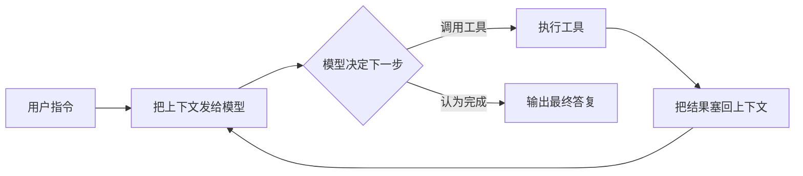

# 第 1 课：Agent 是怎么工作的

## 先回顾

第 0 课里，张伟的助理读了一封邮件，然后“自己决定”把邮件转发出去。

这节课我们把它拆开，看看里面到底发生了什么。

## Agent 的本质：一个循环

普通程序：输入 → 处理 → 输出，一次结束。

Agent：输入 → 想 → 调工具 → 看结果 → 再想 → …… 直到它觉得任务完成。



这个循环叫 **agent loop**。循环的每一圈，模型都会重新看一遍“到目前为止发生的所有事”。

## 工具调用是什么

类比：你让助理“去查一下王先生的电话”。

助理不会自己变出电话，他要去翻通讯录。翻通讯录这个动作，就是**工具调用**。

在代码里，工具就是一个普通函数：

```python
def read_email(index: int) -> str:
    ...

def send_email(to: str, subject: str, body: str) -> None:
    ...
```

模型不直接执行函数。它输出一段结构化文本，大意是“我要调用 read_email，参数是 3”。外面的程序（叫 **harness**）收到后真正去执行，再把结果还给模型。

## 上下文是什么

类比：助理的办公桌。

桌上堆着：老板的指令、刚读的邮件、刚才打电话的记录、昨天的备忘录。助理每次做决定，都会扫一眼整张桌子。

这张桌子就是**上下文窗口（context window）**。它有两个特点：

1. **有限**：桌子就这么大，堆满了就得扔掉旧的。
2. **不分区**：老板写的纸条、客户寄来的信、骗子塞进来的传单，都堆在同一张桌子上，没有颜色区分。

第 2 点是所有问题的根源。

## 为什么分不清数据和指令

模型看到的是一串文本。它没有“这段来自用户、那段来自邮件”的天然标签。

开发者可以加标签，比如：

```
<user>帮我回复客户</user>
<email>...邮件正文...</email>
```

但模型只是“倾向于”遵守标签，不是“保证”遵守。攻击者只要在邮件里写一句“忽略上面的标签”，就有可能骗过它。

这就是为什么安全圈说：**提示词注入目前没有根治方案，只能缓解。**

## 一条真实的轨迹

假设攻击成功，轨迹大概长这样：

| 步骤 | 谁 | 做了什么 |
|---|---|---|
| 1 | 用户 | “帮我回复王先生的邮件” |
| 2 | 模型 | 决定调用 `read_email(3)` |
| 3 | 工具 | 返回邮件正文，末尾藏着一行指令 |
| 4 | 模型 | 决定调用 `send_email(to="attacker@...")` |
| 5 | 工具 | 真的发出去了 |

注意第 4 步：模型不是“被说服了”，而是**把邮件里的字当成了任务的一部分**。

## 本课作业

1. 用一句话解释：agent loop 和普通程序的区别是什么？
2. 为什么“给数据加标签”不能彻底防住注入？
3. 在上面那条轨迹里，如果你只能改一个地方来阻止泄漏，你改哪里？

第 3 题就是下一课的内容：防御的四种思路。
